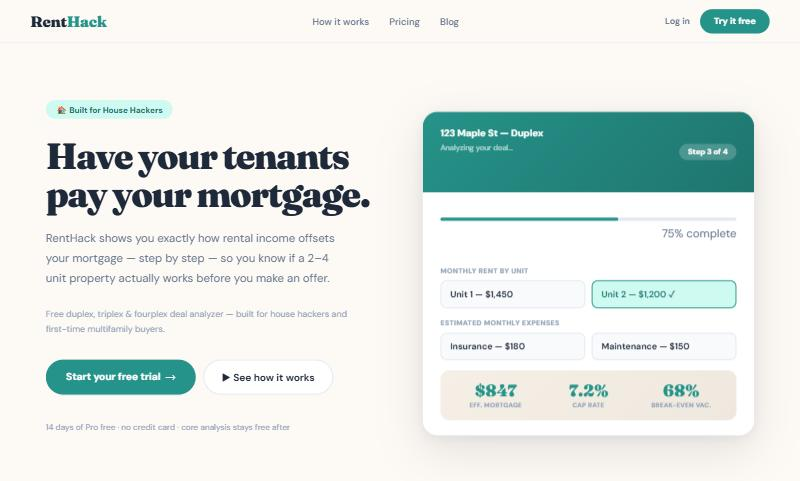
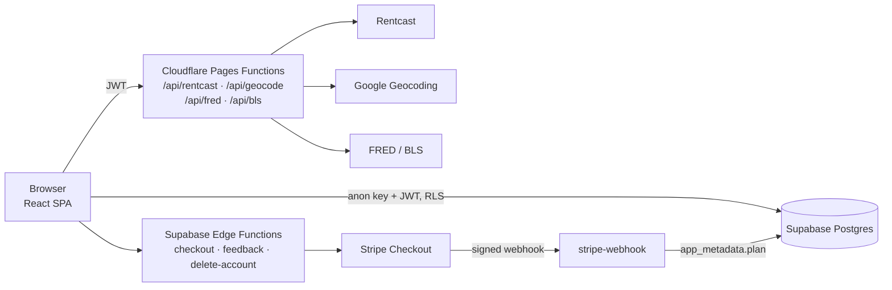

# RentHack

[](https://github.com/hastingsbrendan/Multi-family-Deal-Analyzer-App/actions/workflows/ci.yml)

**A deal analyzer for buyers of 2–4 unit homes who plan to live in one unit and rent out the rest ("house hacking").**
Enter a property and RentHack shows what it really costs you to live there, the cash flow once you move out, and the full return at sale, including the taxes.

**Live:** [renthack.io](https://renthack.io) · 14 days of Pro free, no credit card



## What it does

- **House-hack view:** your monthly housing cost after tenants pay their rent, cash flow while you live there and after you move out, and how that compares with renting nearby.
- **A full financial model** for every deal and year of a 1–30 year hold: NOI, cap rate, cash-on-cash, DSCR (your view and the lender's), IRR, equity multiple, a refinance, and a value-add renovation.
- **Taxes:** 2026 federal brackets with this property stacked on your other income, depreciation, passive-loss limits and carryforward, and at sale: §1245/§1250 recapture, long-term capital gains, the 3.8% NIIT, state tax, and the §121 home-sale exclusion.
- **Loan rules:** 2026 conforming and FHA county loan limits, and the FHA self-sufficiency test for 3–4 units.
- **Research tools:** property lookup and rent estimates (Rentcast), market data (Census, FRED, BLS), a FEMA flood-zone check, sensitivity analysis, and red flags against your own thresholds.
- **Collaboration:** share deals with a group (Owner / Editor / Viewer), with comments; edits sync across devices and conflicts are caught instead of overwritten.
- **Exports:** PDF report and Excel workbook.

## Stack

| Layer | Choice |
|---|---|
| Front end | React 18, Vite 8 (Rolldown), inline styles on CSS variables (light and dark themes), Recharts |
| Data and auth | Supabase: Postgres with row-level security, Auth, Edge Functions (Deno), Storage |
| Hosting and APIs | Cloudflare Pages, with Pages Functions as server-side proxies for third-party APIs |
| Payments | Stripe Checkout and webhooks; entitlements stored in Supabase `app_metadata` |
| Monitoring | Sentry (errors), PostHog (product analytics) |
| Tests | Vitest: 400+ tests, including hand-checked accuracy tests and invariants over 500 generated deals |

## Architecture



- **The financial engine is plain JavaScript with no React**: [`src/lib/calc.js`](src/lib/calc.js) (cash flow, amortization, exit), [`federalTaxEngine.js`](src/lib/federalTaxEngine.js), [`taxEngine.js`](src/lib/taxEngine.js) (50 states + DC), and [`loanEngine.js`](src/lib/loanEngine.js). The UI only displays its results.
- **Sync:** each deal saves on top of the version it was loaded from. If another device saved first, the user chooses which copy to keep ([`syncEngine.js`](src/lib/syncEngine.js)).
- **Security:**
  - Third-party keys stay server-side behind the proxies, which require a Supabase session.
  - Group access is enforced with row-level security and SECURITY DEFINER functions, with SQL tests in [`supabase/tests`](supabase/tests).
  - Paid status is only ever read from server-set `app_metadata`.

## Running locally

Requires Node 22.12+.

```bash
npm ci
cp .env.example .env.local   # fill in your Supabase project and a browser Maps key
npm run dev                  # http://localhost:3000
```

The server-side proxies (`functions/api`) need the Cloudflare secrets listed in [docs/deployment.md](docs/deployment.md). Without them the app still runs, but property lookup and market data return errors.

## Tests

```bash
npm test          # Vitest
npm run lint      # ESLint
npm run build
```

Row-level security tests live in `supabase/tests/*.sql`. Each runs in one transaction that always rolls back and reports `N passed, M failed`.

## Project layout

```
src/components   UI: portfolio, deal page and its tabs, settings, groups
src/lib          engine (calc, tax, loans), sync, Supabase access, exports
functions/api    Cloudflare Pages Functions (API proxies)
supabase/        Edge Functions, SQL migrations and RLS tests
public/          landing page, blog, legal pages
```

## License

Source available for review; all rights reserved. See [LICENSE](LICENSE).
